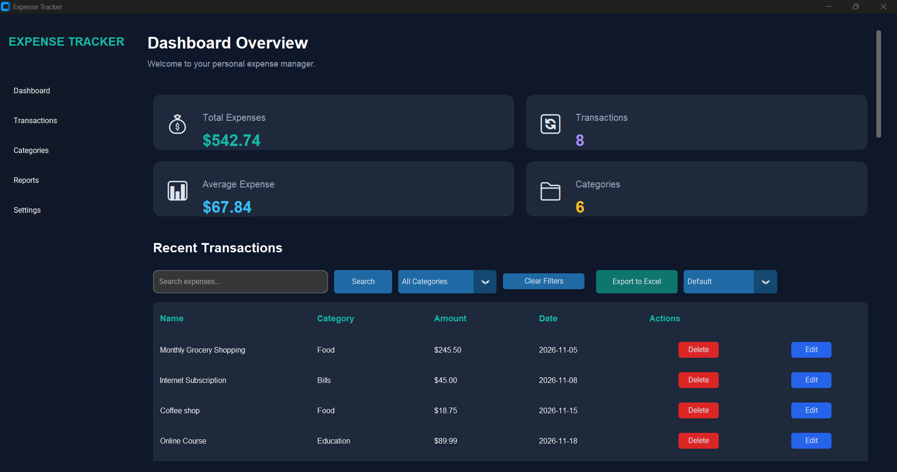
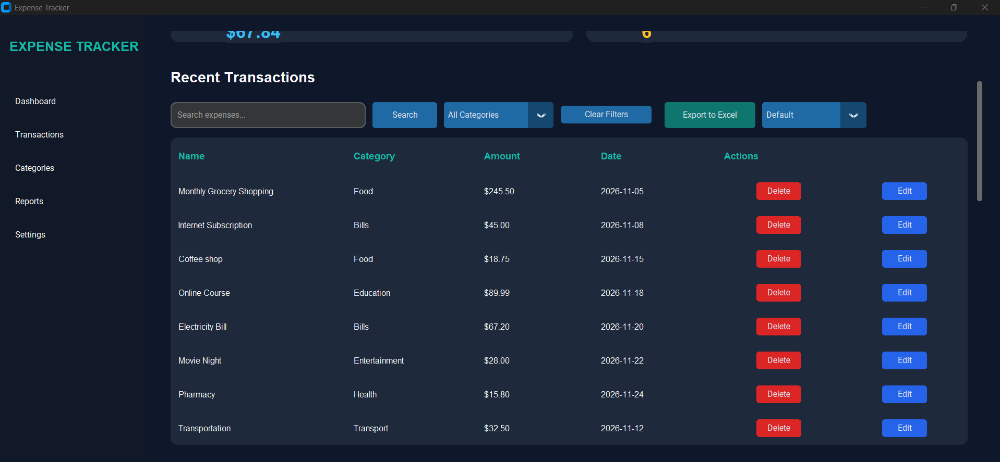
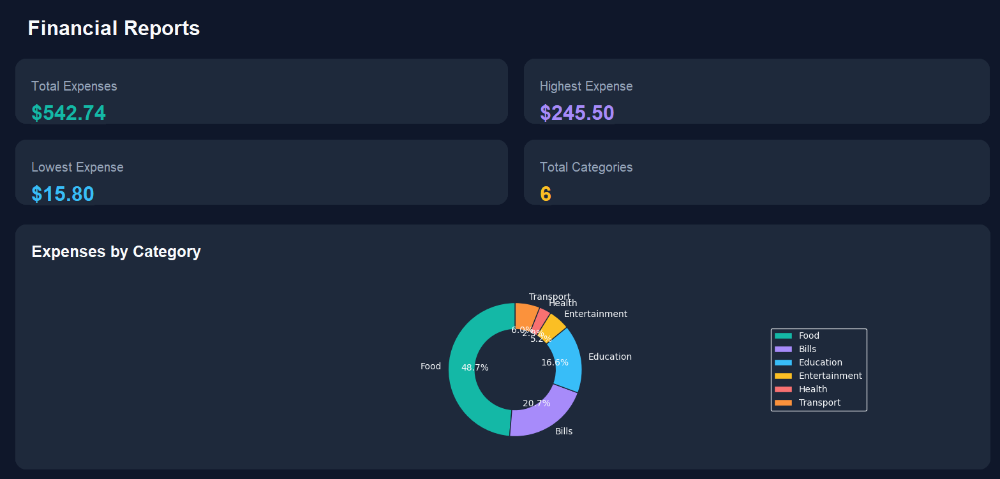
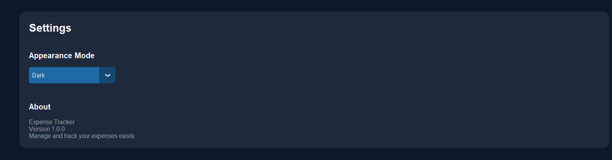

# Python Expense Tracker 🐍

A modern desktop-based expense tracking application built with **Python** and **CustomTkinter**.

The application helps users manage their daily expenses, monitor spending habits, organize transactions, and generate financial reports through an intuitive graphical interface.

## ✨ Features

### Expense Management
- Add new expenses
- Edit existing expenses
- Delete transactions
- View recent transactions
- Automatically save expense data locally

### Dashboard & Analytics
- View total expenses
- Track the number of transactions
- Calculate average expenses
- Identify highest and lowest expenses
- View category summaries

### Search & Filtering
- Search expenses by name
- Filter transactions by category
- Sort transactions by amount
- Sort transactions by date
- Clear active filters

### Financial Reports
- View expenses by category
- Generate monthly expense trend charts
- Visualize spending distribution with charts
- Export transactions to Excel format

## 📸 Screenshots

### Dashboard


### Transactions


### Categories


### Reports


### Settings


## 🛠️ Technologies
- Python
- CustomTkinter
- Matplotlib
- OpenPyXL
- JSON

## ⚙️ Requirements
- Python 3.9 or higher

## 🚀 Installation

1. Clone the repository:

   ```bash
   git clone YOUR_REPOSITORY_URL
   ```

2. Navigate to the project folder:

   ```bash
   cd Python-expense-tracker
   ```

3. Install the required dependencies:

   ```bash
   pip install -r requirements.txt
   ```

## ▶️ How to Run

Run the following command:

```bash
python app.py
```

## 💾 Data Storage

Expense data is stored locally in a JSON file named `expenses.json`.

**Note:** The `expenses.json` file is excluded from Git tracking to protect personal financial data.

## 📊 Excel Export

The application allows users to export their transactions to Excel (`.xlsx`) format.

## 📁 Project Structure

```text
Python-expense-tracker/
│
├── screenshots/
│   ├── dashboard.png
│   ├── transactions.png
│   ├── categories.png
│   ├── reports.png
│   └── settings.png
│
├── app.py
├── requirements.txt
├── README.md
└── .gitignore
```

## 👨‍💻 Author

Created as a Python desktop application project.